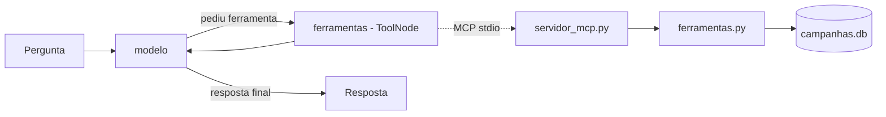

# Agente de Campanhas — Nível 4 (LangGraph + servidor MCP)

Um agente que responde perguntas sobre campanhas de mídia paga (Meta, Google e TikTok) consultando um banco SQLite. As consultas são expostas por um **servidor MCP** e o agente é um **grafo LangGraph**. O projeto mede a taxa de acerto com gabarito em SQL calculado **antes** de rodar.

> **Dados 100% sintéticos.** Este repositório é público e nunca contém dados de clientes.

## O que o projeto faz

- Responde perguntas como "Qual canal teve o maior CPA?" e "O CPA da Meta - Conversão piorou? Desde quando?".
- Descobre as ferramentas em tempo de execução, perguntando ao servidor MCP o que ele oferece.
- Devolve ao modelo a mensagem de erro das ferramentas, para ele corrigir o pedido em vez de inventar um número.

## Arquitetura

- **Grafo** (`grafo_mcp.py`): dois nós, `modelo` e `ferramentas`, e uma aresta condicional. O nó `modelo` usa `claude-haiku-5-5` pelo `ChatAnthropic`. O nó `ferramentas` é o `ToolNode` pronto do LangGraph.
- **Servidor MCP** (`servidor_mcp.py`): FastMCP com 4 ferramentas, abertas por stdio. O adaptador abre uma sessão nova com o servidor a cada chamada de ferramenta.
- **Banco**: `campanhas.db` (SQLite), em `n3-python/agente_campanhas`. Duas tabelas: `campanhas(id, nome, canal)` e `metricas_diarias(campanha_id, data, gasto, impressoes, cliques, conversoes)`.
- **Limite de voltas**: `MAX_VOLTAS = 8`, que vira `recursion_limit = 2 * MAX_VOLTAS + 1`, porque cada volta passa por 2 nós.

### Ferramentas do servidor

| Ferramenta | O que faz |
|---|---|
| `listar_campanhas` | Lista as campanhas e o canal de cada uma |
| `consultar_metricas` | Soma gasto, cliques e conversões e calcula o CPA por campanha num período, com filtros opcionais |
| `metricas_por_dia` | Mostra os números dia a dia de uma campanha |
| `dias_sem_conversao` | Lista os dias com gasto e zero conversões, em todas as campanhas |

## Os dados

- Gerados por script com `random.seed(42)`: 450 linhas, de 28/07/2026 a 25/10/2026, 5 campanhas (Meta - Conversão, Meta - Remarketing, Google - Search, Google - PMax e TikTok - Conversão).
- **Dois problemas plantados**, para testar se o agente acha a causa certa:
  1. **Meta - Conversão:** a taxa de conversão cai pela metade a partir de 07/10 (CPA 49,77 até 06/10 e 101,72 a partir de 07/10, confirmado por SQL).
  2. **Google - Search:** quatro dias com gasto e zero conversões, de 16 a 19/10.

## Estrutura da pasta

| Arquivo | Para que serve |
|---|---|
| `config.py` | Modelo, preços, limite de voltas e o `SISTEMA` (as instruções do agente) |
| `ferramentas.py` | As consultas SQL, a validação de datas e a descrição das ferramentas |
| `agent.py` | Agente do zero: a classe `Agent` (estado, ferramentas e loop separados) |
| `grafo.py` | O mesmo agente como grafo LangGraph, com as ferramentas no código |
| `servidor_mcp.py` | Servidor MCP com as 4 ferramentas |
| `testar_servidor.py` | Cliente de teste: abre o servidor, lista e chama as ferramentas |
| `grafo_mcp.py` | **Agente final**: grafo LangGraph com as ferramentas vindas do servidor MCP |
| `grafo_memoria.py` | Memória entre execuções com `SqliteSaver` (conversa guardada em `memoria.db`) |
| `grafo_humano.py` | Aprovação humana (`interrupt`) antes de uma ação sensível (envio de relatório simulado) |
| `crew_relatorio.py` | Comparação com CrewAI (ambiente separado, Python 3.12) |
| `perguntas_n4.py`, `perguntas_n4_r2.py`, `perguntas_n4_falhas.py` | As perguntas e o gabarito de cada rodada |
| `avaliar_n4.py` | Roda um arquivo de perguntas e grava o CSV para correção |
| `testar_falhas.py` | Provoca falhas de propósito (campanha inexistente, período sem dados, servidor fora do ar) |
| `gabarito_n4.sql`, `verificacao_n4.sql` | O gabarito em SQL e a conferência dos números extras |
| `resultados_n4_*.csv` | Resultados antes e depois das correções, com as notas |

## Como rodar

1. Ambiente (testado em macOS Intel com Python 3.14.4): `pip install -r requirements.txt`. O SDK de MCP fica na versão 1.x (`mcp<2`), porque o adaptador do LangChain ainda não aceita a 2.x.
2. Chave da API: crie um arquivo `.env` na raiz do projeto com `ANTHROPIC_API_KEY=...`. **Nunca commite esse arquivo.**
3. Banco: o `campanhas.db` não vai para o Git. Os scripts do N3 (`n3-python/agente_campanhas`) recriam os dados sintéticos; veja o README daquela pasta.
4. Testar o servidor: `python testar_servidor.py` (deve listar 4 ferramentas).
5. Rodar o agente com 3 perguntas de exemplo: `python grafo_mcp.py`.
6. Avaliar: `python avaliar_n4.py` (13 perguntas), `python avaliar_n4.py perguntas_n4_r2` (rodada 2) ou `python avaliar_n4.py perguntas_n4_falhas` (teste das falhas).

## Tratamento de falhas

| Cenário | O que acontece |
|---|---|
| Data em formato inválido | A ferramenta levanta `ValueError: data_inicio inválida: '2026/10/01'. Use o formato AAAA-MM-DD.`, e a mensagem chega ao modelo. Testado nas 3 ferramentas que recebem data |
| Campanha inexistente | O agente não inventa número: lista as campanhas válidas e pergunta se o nome estava errado |
| Período sem dados | Diz que não há dados e informa o intervalo disponível (28/07 a 25/10) |
| Servidor MCP fora do ar | O programa termina sozinho com `Não consegui conectar ao servidor MCP: ...`, sem travar |
| Limite de voltas estourado | Devolve "Parei: limite de voltas atingido sem resposta final." |

## Avaliação

**Método.** Para cada pergunta, o gabarito é calculado em SQL antes de rodar o agente. Quem corrige é uma pessoa, com esta regra:
- **1** = resposta principal certa e todo número citado bate com o SQL (diferença de até 0,01 de arredondamento) e nada inventado.
- **0,5** = principal certa, mas algum número ou afirmação secundária errada.
- **0** = principal errada ou dado inventado.

A taxa de acerto conta só as notas 1.

**Perguntas.** 10 perguntas herdadas do N3, 3 perguntas novas que o agente nunca tinha visto (N1 a N3) e uma **rodada 2** com 6 perguntas mais difíceis (causa que os dados não mostram, métrica sem dado, data ambígua, ranking, mês incompleto e moeda).

### Resultados

| Rodada | Antes das correções | Depois das correções |
|---|---|---|
| 13 perguntas (10 do N3 + 3 novas) | 13 de 13 | 13 de 13 |
| Rodada 2 (6 perguntas difíceis) | 4 de 6 (2 parciais) | 6 de 6 |
| **Total (19 perguntas)** | **17 de 19** | **19 de 19** |
| Teste das 2 falhas (9 perguntas, 3 de cada tipo) | 7 de 9 (2 parciais) | **9 de 9** |

Custo e tempo (soma dos custos impressos por pergunta): as 19 perguntas custaram cerca de **US$ 0,0118** antes e **US$ 0,0120** depois, com média de cerca de 4 s por pergunta (76,8 s e 72,6 s no total).

### As 2 correções

As duas falhas apareceram só na rodada 2 e foram reproduzidas no teste de 9 perguntas:

1. **Ranking com a ordem errada.** O agente escrevia uma lista com a ordem errada (Google - PMax, CPA 59,13, antes de Meta - Conversão, CPA 55,63) e se corrigia no mesmo texto. Regra acrescentada ao `SISTEMA`: *ordenar antes de escrever e entregar só a lista final.* Antes: 1 erro em 3 execuções. Depois: 0 em 3.
2. **"Menor CPA" atribuído à campanha errada.** Numa pergunta sobre o CPA de "ontem", o agente apontou o Google - Search (27,73) como menor CPA, quando era a Meta - Remarketing (26,86). Regra acrescentada: *responder só o que foi perguntado e conferir todos os valores antes de apontar o menor ou o maior.* Antes: 1 erro em 3 execuções. Depois: 0 em 3, e quando o agente cita o menor e o maior por conta própria, os números estão certos.

Depois de mudar o `SISTEMA`, as 19 perguntas foram rodadas de novo, para detectar regressões. Não houve nenhuma.

### Comparação com o N3

| | N3 (agente do zero) | N4 (LangGraph + MCP) |
|---|---|---|
| Acerto nas mesmas 10 perguntas | 80% na 1ª rodada; 90% depois de 2 correções | 10 de 10 |
| Custo das 10 perguntas | cerca de US$ 0,0085 | cerca de US$ 0,0061 (antes das correções) |

A comparação **não é justa para medir melhora**: o `SISTEMA` e a ferramenta `dias_sem_conversao` do N4 já carregam as correções feitas no N3, olhando essas mesmas 10 perguntas. O que ela mostra é que trocar a arquitetura **não piorou** o agente. As 3 perguntas novas e a rodada 2 são a evidência mais independente.

## Decisões técnicas

- **`mcp<2`**: o SDK de MCP 2.x renomeou o `FastMCP`, e o adaptador do LangChain ainda exige a 1.x. A versão fica fixada.
- **`effort="low"` e nenhum `temperature`**: o modelo `claude-haiku-5-5` não aceita `temperature`.
- **CrewAI em ambiente separado**: ele exige Python abaixo de 3.14. Em Mac Intel, o pip instala a versão 1.9.3 (as mais novas dependem de um pacote sem versão para esse tipo de Mac).
- **Erros de ferramenta voltam ao modelo com a mensagem completa**: é o que permite ao agente se corrigir (por exemplo, listar as campanhas válidas depois de um nome errado).
- **Custo com memória**: o histórico é reenviado a cada chamada, e o custo de cada pergunta cresce com a conversa. O custo impresso com memória é o acumulado, não o da pergunta.

## Limitações

- **Dados sintéticos** e de um período curto (90 dias). Nada aqui foi testado com dados reais.
- **Amostras pequenas.** O teste das correções tem 9 execuções contra 9. Se a regra não tivesse efeito, a chance de as 2 falhas caírem todas no grupo "antes" seria de cerca de 24%: é um indício, não uma prova.
- **As duas regras foram mudadas ao mesmo tempo**, então não dá para dizer qual resolveu cada falha.
- **O modelo não é determinístico.** A mesma pergunta pode ser respondida de jeitos diferentes (por exemplo, "ontem" foi interpretado como 24/10 numa execução e 25/10 em outras).
- **O `SISTEMA` foi ajustado olhando perguntas que o agente já conhecia** (as do N3), então a taxa nessas perguntas é otimista.
- **A moeda não consta nos dados.** As respostas usam "R$" por convenção; o agente, quando perguntado, diz que a moeda não é informada.
- **O agente não mede a própria incerteza**: quando erra, erra com o mesmo tom de quando acerta.
- **CrewAI e Managed Agents entraram só como comparação**: o CrewAI não mostra custo por execução, e o Managed Agents foi apenas lido na documentação, não testado.

## Segurança e dados

- O `.env`, os arquivos `*.db` (incluindo `memoria.db`, que guarda as conversas em texto legível) e a pasta `.venv-crew` ficam fora do Git.
- O envio de relatório é **simulado** (grava um arquivo local) e sempre passa por aprovação humana.
- Antes de commitar, confira que nenhuma chave da API entrou no diff (`git diff --cached`) e que o `.env` não aparece em `git status`.

## Próximos passos (Nível 5)

Documentação das métricas por RAG, avaliação automatizada, pipeline agendado com envio por Telegram e deploy.